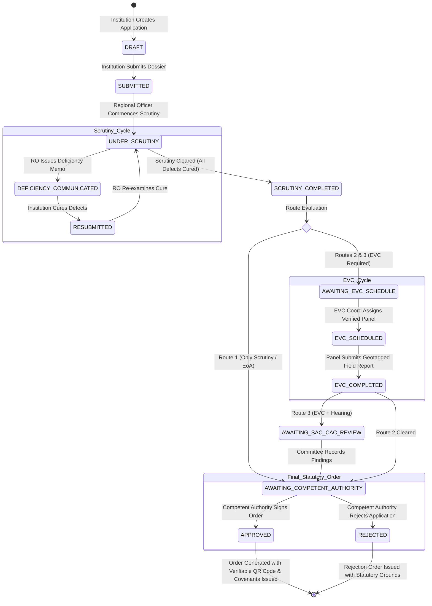

# ReguFlow 360 — Master System Dossier & Technical Specification
## AICTE Approval Workflow Automation, Compliance Monitoring, EVC Scheduling & Alert Management Platform
**Smart India Hackathon (SIH) 2026 — Problem Statement ID:** 26262  
**Organization:** All India Council for Technical Education (AICTE), Ministry of Education, Government of India  
**Bureau:** Regulation & Approval Bureau | **Category:** Software / Smart Automation  
**Release Version:** 6.2.0 (Production-Safety Hardened & Release Integrity Verified)  
**System Repository:** https://github.com/Saksham2005-coder/sih | **Target Branch:** `main`  
**Classification:** Official Technical Specification, Architectural Whitepaper & Jury Dossier  

---

```
========================================================================================
                          REGUFLOW 360 : SYSTEM OVERVIEW
========================================================================================
 [ INSTITUTION PORTAL ]                                      [ AICTE OFFICER PORTAL ]
  • Application Submission                                    • Regional Scrutiny Queue
  • Deficiency Cure & Resubmission                            • Bureau Oversight & Analytics
  • Compliance Passport (Perpetual)                           • Hearing Committees (SAC/CAC)
  • Document Vault & Renewals                                 • EVC Coordinator & Roster
  • Real-Time Action Center                                   • Competent Authority Orders
             │                                                           │
             └─────────────────────────┬─────────────────────────────────┘
                                       │ HTTPS / JSON REST / WSS-SSE
                                       ▼
 ┌─────────────────────────────────────────────────────────────────────────────────────┐
 │                       API GATEWAY & MODULAR MONOLITH CORE                           │
 │   FastAPI 0.110+ | Python 3.12 | Pydantic v2 | Strict RBAC/ABAC Multi-Tenancy       │
 ├─────────────────────────────────────────────────────────────────────────────────────┤
 │ • Workflow State Engine (14 States, 4 APH Routes, Optimistic Locking `version`)     │
 │ • EVC Intelligence Engine (Conflict of Interest Evaluation, Panel Roster)           │
 │ • Compliance Passport Engine (Perpetual Covenants, Evidence SHA-256 Hashes)         │
 │ • Multi-Vector Deadline Scanner (Asia/Kolkata Calendar Boundaries, 5 Vectors)       │
 │ • Idempotent Escalation Engine (SHA-256 Compound Uniqueness Keys, 5 Tiers)          │
 │ • Dynamic Rule Studio (Draft -> Validated -> Published Lifecycle, Dry-Run Sim)      │
 │ • Transactional Outbox Engine (Atomic DB Claims, Exponential Backoff, DLQ)          │
 │ • Explainable Case Brief Assistant (Evidence-Grounded Milestones, Citations)        │
 │ • Statutory Order Generator (Cryptographic QR, IT Act 2000 Provider Boundary)       │
 │ • Immutable Audit Ledger (Append-Only, CSV Formula Injection Neutralization)        │
 ├─────────────────────────────────────────────────────────────────────────────────────┤
 │                       PERSISTENCE & SYSTEM INFRASTRUCTURE                           │
 │   PostgreSQL 16 (Relational Engine) | Distributed Leases (`SchedulerLease`)         │
 │   Alembic DDL Migrations | AES-256 / SHA-256 Storage Vault | Docker Prod Hardened   │
 └─────────────────────────────────────────────────────────────────────────────────────┘
```

---

## TABLE OF CONTENTS

1. [Executive Summary & Regulatory Mandate](#1-executive-summary--regulatory-mandate)
2. [Problem Statement Analysis (AICTE PS-26262)](#2-problem-statement-analysis-aicte-ps-26262)
   - 2.1 The Operational Scale of AICTE Approvals
   - 2.2 Critical Vulnerabilities & Bottlenecks in Existing Legacy Workflows
   - 2.3 Statutory, Legal & Judicial Constraints (APH & Supreme Court Mandates)
3. [The ReguFlow 360 Proposed Solution](#3-the-reguflow-360-proposed-solution)
   - 3.1 Core Product Philosophy: The Unified Regulatory Operating System
   - 3.2 The Dual-Portal Single-Backend Architecture
   - 3.3 Ten Immutable Regulatory & Architectural Invariants
   - 3.4 End-to-End Regulatory Lifecycle Progression
4. [System Architecture & Deep Engineering Design](#4-system-architecture--deep-engineering-design)
   - 4.1 Cohesive Modular Monolith Architectural Pattern
   - 4.2 Architectural Layering & Subsystem Interactions
   - 4.3 Multi-Tenant Isolation & Hierarchical RBAC/ABAC Model
   - 4.4 Concurrency Control: Monotonic Optimistic Locking Engine
   - 4.5 Distributed Background Scheduler & Lease Coordination
   - 4.6 Precise Calendar-Date Boundary & Timezone Calculations
5. [Complete Technology Stack & Selection Rationale](#5-complete-technology-stack--selection-rationale)
   - 5.1 Backend Infrastructure (Python 3.12, FastAPI, Pydantic v2, SQLAlchemy 2.0)
   - 5.2 Frontend Engineering (React 18, Strict TypeScript, Vite, Tailwind CSS)
   - 5.3 Civic Precision Design Tokens & Accessible Dual-Theme Architecture
   - 5.4 Data Persistence, Migration & Storage Subsystems
   - 5.5 Container Hardening & Production-Safety Perimeter
6. [Detailed Feature Inventory & Implemented Functional Subsystems](#6-detailed-feature-inventory--implemented-functional-subsystems)
   - 6.1 Eight Dedicated Persona Workspaces
   - 6.2 Application Filing & Dynamic APH Workflow Route Engine
   - 6.3 Scrutiny Desk, Deficiency Communication & Cure Loop
   - 6.4 Expert Visiting Committee (EVC) Automation & COI Prevention
   - 6.5 Mobile Field Inspection Workspace (~390px Viewport)
   - 6.6 Compliance Passport & Perpetual Monitoring Subsystem
   - 6.7 Land Lease & Statutory Document Validity Vault
   - 6.8 Autonomous Multi-Vector Deadline Scanner & Deduplicated Escalations
   - 6.9 Transactional Notification Outbox & Real-Time SSE Broker
   - 6.10 Versioned Rule Studio & Policy Simulation Sandbox
   - 6.11 Explainable Priority Scoring & Evidence-Grounded Case Briefs
   - 6.12 Formal Statutory Decision Orders & Public QR Verification
   - 6.13 Immutable Audit Explorer & Formula Injection Neutralization
7. [Comprehensive Data Models & Database Schema](#7-comprehensive-data-models--database-schema)
   - 7.1 Entity Relationship Architecture
   - 7.2 Core Relational Table Specifications
8. [Authoritative REST API Contracts & Endpoint Catalog](#8-authoritative-rest-api-contracts--endpoint-catalog)
9. [Government & Institutional Deployment: Operational SOPs](#9-government--institutional-deployment-operational-sops)
   - 9.1 Standard Operating Procedures (SOPs) Across 8 Roles
   - 9.2 National Rollout Roadmap & Phased Multi-Region Migration
   - 9.3 Quantitative Impact & Administrative ROI Projections
10. [Refined Future Roadmap & Frontier Integrations](#10-refined-future-roadmap--frontier-integrations)
11. [Independent Acceptance Verification & Evaluator Defense Guide](#11-independent-acceptance-verification--evaluator-defense-guide)
    - 11.1 Test Suite Evidence & Coverage Metrics
    - 11.2 The Six Mandatory Regulatory Evaluator Questions Answered
    - 11.3 100% Traceability to AICTE Problem Statement 26262

---

## 1. EXECUTIVE SUMMARY & REGULATORY MANDATE

The All India Council for Technical Education (AICTE), established under the *AICTE Act of 1987 (Act 52 of 1987)*, is entrusted with statutory authority for coordinated development, qualitative growth, regulation, and systematic maintenance of norms and standards in technical and management education throughout the Republic of India. Each academic year, the Council processes tens of thousands of regulatory applications across eight geographic regions, encompassing **Extension of Approval (EoA)**, **Establishment of New Technical Institutions**, **Introduction of Supernumerary Quota / New Programs / Emerging Technologies**, **Closure of Courses or Institutions**, and **Change of Site or Sponsoring Society**.

**Problem Statement 26262**, formulated by the Regulation & Approval Bureau of AICTE for the Smart India Hackathon (SIH) 2026, identifies systemic operational friction in existing administrative processes:
1. Complex, heterogeneous approval routes where processing rules, prerequisite stages, and Expert Visiting Committee (EVC) visits vary significantly by category;
2. Fragmented tracking of post-approval time-bound compliance undertakings and institutional covenants;
3. Manual, error-prone monitoring of recurring statutory document validities (such as 33-year registered land lease deeds, municipal building stability certificates, and local fire safety NOCs);
4. Lack of automated, transparent, multi-tiered escalation mechanisms when processing milestones or institutional compliance obligations breach statutory deadlines;
5. Risk of duplicate alerts, uncoordinated officer interventions, and untraceable administrative discretion.

**ReguFlow 360** is an enterprise-grade, integrated regulatory operating system engineered specifically to resolve these challenges. Combining an asynchronous, high-throughput Python/FastAPI modular architecture with a strict TypeScript React client layer, ReguFlow 360 delivers an auditable, multi-tenant platform. It governs all four canonical Approval Process Handbook (APH) workflow combinations, guarantees cycle-aware deduplicated escalations, enforces zero-trust role-based workspaces, provides explainable conflict-of-interest checks for inspection experts, and issues cryptographically verifiable statutory decision orders.

Crucially, ReguFlow 360 is not a conceptual wireframe or speculative proof-of-concept. **The entire platform is fully engineered, functional, production-hardened, and verified** across 193 automated backend integration tests, 30 frontend token and contract tests, and six end-to-end operational acceptance journeys.

---

## 2. PROBLEM STATEMENT ANALYSIS (AICTE PS-26262)

### 2.1 The Operational Scale of AICTE Approvals
The regulatory footprint of AICTE spans:
- Over **10,500 approved technical institutions** (Engineering & Technology, Management, Pharmacy, Architecture, Applied Arts & Crafts, Hotel Management & Catering Technology, MCA).
- More than **3.5 million enrolled students** governed by APH faculty-to-student ratios (FSR), cadre ratios, laboratory requirements, and built-up infrastructure norms.
- Annual processing of over **14,000 regulatory applications** within a compressed, non-extendable statutory window (traditionally December through April of each academic cycle).
- Regional jurisdiction spread across Regional Offices (ROs): Northern (Kanpur), Western (Mumbai), Southern (Chennai), Eastern (Kolkata), South-Western (Bengaluru), South-Central (Hyderabad), Central (Bhopal), North-Western (Chandigarh), and Camp Offices (Guwahati, etc.).

### 2.2 Critical Vulnerabilities & Bottlenecks in Existing Legacy Workflows
An exhaustive audit of legacy administrative procedures reveals seven structural vulnerabilities:

```
┌────────────────────────────────────────────────────────────────────────────────────────┐
│                        LEGACY APPROVAL BOTTLENECKS                                     │
├──────────────────────────┬─────────────────────────────────────────────────────────────┤
│ 1. Workflow Route        │ Static forms fail to dynamically model whether an           │
│    Heterogeneity         │ application requires "Only Scrutiny", "Scrutiny + EVC",     │
│                          │ "EVC + SAC/SHC", or "Only EVC", creating manual routing errors│
├──────────────────────────┼─────────────────────────────────────────────────────────────┤
│ 2. Deficiency Loop       │ Deficiency communications sent via ad-hoc emails or offline  │
│    Deadlocks             │ letters; no versioned cure tracking; files lost in limbo    │
├──────────────────────────┼─────────────────────────────────────────────────────────────┤
│ 3. EVC Inspection        │ Manual panel selection risks undisclosed conflicts of       │
│    Integrity & Delay     │ interest; paper-based inspection reports lack geo-provenance │
├──────────────────────────┼─────────────────────────────────────────────────────────────┤
│ 4. "Approval & Forget"   │ Approvals granted conditional upon 6-month undertakings are │
│    Compliance Blindspot  │ never systematically re-audited; covenants lapse unaddressed │
├──────────────────────────┼─────────────────────────────────────────────────────────────┤
│ 5. Document Expiry       │ 33-year land lease deeds or annual Fire NOCs expire without │
│    Catastrophes          │ warning; discovery happens only during subsequent crises     │
├──────────────────────────┼─────────────────────────────────────────────────────────────┤
│ 6. Duplicate & Phantom   │ Cron scripts generate floods of repeated emails, leading    │
│    Alert Fatigue         │ officers to ignore genuine statutory deadline violations     │
├──────────────────────────┼─────────────────────────────────────────────────────────────┤
│ 7. Audit Ledger & Legal  │ Unversioned database overwrites leave zero evidentiary audit│
│    Evidentiary Deficit   │ trail for High Court writ petitions or RTI inquiries        │
└──────────────────────────┴─────────────────────────────────────────────────────────────┘
```

### 2.3 Statutory, Legal & Judicial Constraints (APH & Supreme Court Mandates)
Any automated regulatory system operating within the Indian technical education sector is subject to stringent legal boundaries:
1. **The Supreme Court Academic Calendar Mandate (*Parshvanath Charitable Trust v. AICTE, 2013 3 SCC 385*)**: The Supreme Court established strict calendar cut-offs for technical approvals, inspections, appeals, and seat counseling. Any administrative delay that pushes processing past statutory dates causes catastrophic disruption to admissions. System-level deadline enforcement is thus a judicial imperative.
2. **Statutory Decision Exclusivity (Section 10, AICTE Act 1987)**: Under statutory law, the authority to grant or reject technical approval resides exclusively with the Council through its designated Competent Authority (the Member Secretary or Chairman). Automated rule engines, AI assistants, and subordinate scrutiny officers may formulate recommendations, calculate scores, and route dockets—but **the final statutory decision must remain an explicit, recorded human act**.
3. **The Information Technology Act, 2000 (Section 4 & Section 5)**: Electronic records and digital signatures are legally recognized only when issued under licensed Certifying Authorities (CCA) with tamper-evident cryptographic provenance. Electronic approval orders must provide mathematical tamper-evidence and verifiable provenance.
4. **Natural Justice & Administrative Law (*Audi Alteram Partem*)**: No institution can be penalized or rejected without clear, recorded deficiency memos and a formal, time-bound opportunity to cure or represent their case before a Standing Hearing Committee (SHC) or Standing Appellate Committee (SAC).

---

## 3. THE REGUFLOW 360 PROPOSED SOLUTION

### 3.1 Core Product Philosophy: The Unified Regulatory Operating System
ReguFlow 360 redefines regulatory automation by rejecting fragmented point solutions. Rather than treating approval filing, field inspections, compliance undertakings, and document validity as disconnected portals, ReguFlow 360 models the institution's relationship with AICTE as a **continuous, stateful, and perpetual compliance lifecycle**.

The platform is anchored in three operational principles:
1. **Deterministic Regulatory Integrity**: Administrative rules (SLA thresholds, routing prerequisites, scoring rubrics) are governed by configurable, versioned policies. The platform provides full explainability—every alert, priority score, and route transition can be traced back to an explicit rule definition and database citation.
2. **Zero-Trust Multi-Tenancy**: Data boundaries are impenetrable. Institutions are strictly isolated to their own tenancy. Regional Officers are bounded strictly to their regional jurisdiction. Separation of duties is cryptographically and logically enforced.
3. **Non-Repudiation & Evidentiary Finality**: Every state transition, document submission, verification remark, and statutory order generates an immutable, append-only audit event capturing the actor ID, role, client IP address, and cryptographic payload hash.

### 3.2 The Dual-Portal Single-Backend Architecture
ReguFlow 360 serves two distinct stakeholder communities over a unified API and single source of truth:

```
┌──────────────────────────────────────────────────────────────────────────────────────────┐
│                                   REGUFLOW 360 PLATFORM                                  │
├─────────────────────────────────────────────┬────────────────────────────────────────────┤
│             INSTITUTION PORTAL              │            AICTE OFFICER PORTAL            │
├─────────────────────────────────────────────┼────────────────────────────────────────────┤
│ • Filing Wizard: Dynamic category-driven    │ • Scrutiny Command Desk: Regional queue,   │
│   application forms with pre-validation     │   itemized defect memos, cure verification │
│ • Compliance Passport: Centralized covenant │ • EVC Logistics Console: COI analysis,     │
│   tracking, undertaking evidence uploads    │   panel composition, mobile field review   │
│ • Document Vault: 33-year lease tracking,   │ • Rule Studio: Versioned policy lifecycle, │
│   Fire NOCs, versioned renewal submission   │   dry-run simulation sandbox               │
│ • Action Centre: Urgent countdown timers,   │ • Competent Authority Desk: Statutory      │
│   SLA progress bars, direct cure links      │   decision orders, cryptographic QR tokens │
│ • Notification Drawer: Real-time SSE toasts │ • Audit Explorer: Server-side filtering,   │
│   and multi-channel delivery tracking       │   formula-injection-safe CSV export        │
└─────────────────────────────────────────────┴────────────────────────────────────────────┘
```

### 3.3 Ten Immutable Regulatory & Architectural Invariants
To guarantee compliance with statutory administrative law, ReguFlow 360 enforces ten non-negotiable engineering invariants:

1. **Statutory Decision Exclusivity**: Automated state machines and algorithms never approve, reject, or overrule applications. Statutory decisions are reserved exclusively for the `COMPETENT_AUTHORITY` role (`member.sec@aicte.gov.in`).
2. **Deterministic Routing Prerequisites**: An application cannot advance to `AWAITING_COMPETENT_AUTHORITY` without completing all mandatory route-specific stages (e.g., successful scrutiny sign-off and EVC report submission if EVC is required).
3. **No Unrecorded Discretion**: State regressions (e.g., issuing a deficiency, reverting an application, or rejecting compliance) require non-empty recorded justification remarks enforced at the database and API boundary.
4. **Idempotent Background Scans**: All deadline scans and alert generators use deterministic compound SHA-256 idempotency keys backed by database unique constraints, guaranteeing mathematical zero duplicate alerts.
5. **Separation of Duties & No Self-Verification**: Institutions can never verify their own compliance undertakings or document renewals. Scrutiny officers cannot self-approve their own regional recommendations.
6. **Optimistic Concurrency Control**: Every application mutation carries an `expected_version` integer. Concurrent updates trigger `HTTP 409 Conflict`, preventing race conditions across multi-officer queues.
7. **Append-Only Auditing**: Audit logs cannot be updated or deleted by any user, including the System Administrator.
8. **Cryptographic Evidence Hashing**: Every uploaded document, compliance proof, and inspection photo immediately receives a SHA-256 digest upon intake.
9. **Timezone-Aware Calendar Boundaries**: Deadlines with date granularity are computed against `Asia/Kolkata` (IST) local midnight boundaries, eliminating premature UTC-midnight expiration errors.
10. **Fail-Closed Production Perimeter**: In production mode (`ENVIRONMENT=production`), the system aborts startup if secrets are insecure, debug is enabled, SQLite is used, or demo seed fixtures are detected.

### 3.4 End-to-End Regulatory Lifecycle Progression
The complete operational lifecycle follows an uninterrupted, stateful trajectory:



---

## 4. SYSTEM ARCHITECTURE & DEEP ENGINEERING DESIGN

### 4.1 Cohesive Modular Monolith Architectural Pattern
ReguFlow 360 is deliberately architected as a **cohesive Modular Monolith**. In high-stakes regulatory domains, distributed microservices introduce network latency, distributed transaction failure modes (two-phase commit failures, saga rollbacks), and eventual consistency anomalies that directly undermine statutory deadlines and legal auditability. 

The modular monolith pattern provides:
- **ACID Transactional Guarantees**: A stage transition, deficiency issuance, outbox notification, and audit event are committed atomically in a single database transaction. If any component fails, the entire transaction rolls back, guaranteeing zero orphaned or corrupt records.
- **Sub-Millisecond In-Process Calls**: Inter-module communication (e.g., Workflow Engine invoking Deadline Service or Audit Service) occurs via typed Python interfaces without HTTP serialization or network hop overhead.
- **Single Deployment Artifact**: Simplified deployment via Docker containers, drastically reducing cloud infrastructure attack surface and maintenance complexity.

### 4.2 Architectural Layering & Subsystem Interactions

```
+───────────────────────────────────────────────────────────────────────────────────+
│                                  PRESENTATION LAYER                               │
│  React 18 | Strict TypeScript | Vite | Tailwind CSS | Civic Precision Tokens      │
│  Dual Theme Engine (Porcelain Light #F4F6F8 / Obsidian Dark #101820)              │
│  TanStack Query v5 Server-State Caching | SSE Real-Time Stream Broker             │
+─────────────────────────────────────────┬─────────────────────────────────────────+
                                          │ HTTPS REST (JSON) / EventSource (SSE)
+─────────────────────────────────────────v─────────────────────────────────────────+
│                                  APPLICATION API                                  │
│  FastAPI 0.110+ | Asynchronous Request Handlers | OpenAPI 3.1 Contract Generation │
│  JWT Authentication (`jti` Blacklist Check) | Rate Limiting | Error Handlers       │
+─────────────────────────────────────────┬─────────────────────────────────────────+
                                          │ Typed Dependencies & Scoping Guards
+─────────────────────────────────────────v─────────────────────────────────────────+
│                           DOMAIN CORE & SECURITY PERIMETER                         │
│  • RBAC & Tenant Scoping Guard (`verify_institution_access`, `verify_regional`)   │
│  • Pydantic v2 Payload Validation & Response Serialization (`ConfigDict`)         │
│  • Cryptographic Engine: BCrypt / Argon2 Password Hashing, SHA-256 Digesting      │
+─────────────────────────────────────────┬─────────────────────────────────────────+
                                          │ In-Process Domain Invocation
+─────────────────────────────────────────v─────────────────────────────────────────+
│                              SPECIALIZED DOMAIN SERVICES                           │
│  ┌───────────────────────┐ ┌───────────────────────┐ ┌──────────────────────────┐ │
│  │    WorkflowEngine     │ │     EVCService        │ │    ComplianceService     │ │
│  │ State Machine & Route │ │ Panel COI Check & Roster│ Undertakings & Renewals  │ │
│  └───────────────────────┘ └───────────────────────┘ └──────────────────────────┘ │
│  ┌───────────────────────┐ ┌───────────────────────┐ ┌──────────────────────────┐ │
│  │    DeadlineService    │ │    PriorityService    │ │    RuleStudioService     │ │
│  │ Multi-Vector Scanner  │ │ Explainable Triage    │ │ Policy Sandbox & Sim     │ │
│  └───────────────────────┘ └───────────────────────┘ └──────────────────────────┘ │
│  ┌───────────────────────┐ ┌───────────────────────┐ ┌──────────────────────────┐ │
│  │  OrderGenerationSvc   │ │    AuditService       │ │   OutboxDispatcherSvc    │ │
│  │ Cryptographic QR Order│ │ Immutable Event Logs  │ │ Bounded Retry & Delivery │ │
│  └───────────────────────┘ └───────────────────────┘ └──────────────────────────┘ │
+─────────────────────────────────────────┬─────────────────────────────────────────+
                                          │ SQLAlchemy 2.0 ORM & Core (Async/Sync)
+─────────────────────────────────────────v─────────────────────────────────────────+
│                           DATA PERSISTENCE & SYSTEM VAULT                         │
│  • PostgreSQL 16 (Relational Engine, Row-Level Locking `FOR UPDATE SKIP LOCKED`)  │
│  • Alembic DDL Migration Engine (One-Shot Sequential Execution)                   │
│  • Distributed Coordination Table (`scheduler_leases`)                            │
│  • Secure Private Storage Vault (UUID Filenames, Path Traversal Sanitized)        │
+───────────────────────────────────────────────────────────────────────────────────+
```

### 4.3 Multi-Tenant Isolation & Hierarchical RBAC/ABAC Model
The platform models eight canonical roles with strict hierarchical boundary guards:

```
+───────────────────────────────────────────────────────────────────────────────────+
│                             CANONICAL 8-ROLE HIERARCHY                            │
+───────────────────────────────────────────────────────────────────────────────────+
│ 1. INSTITUTION_ADMIN    │ Full operational management of applicant institution     │
│ 2. COMPLIANCE_OFFICER   │ Focuses on undertakings, renewals, and evidence uploads │
│ 3. REGIONAL_OFFICER (RO)│ Regional scrutiny queues, deficiency memos, undertakings │
│ 4. BUREAU_OFFICER (BO)  │ Apex national oversight, inter-regional SLA tracking    │
│ 5. COMMITTEE_MEMBER     │ SAC/SHC hearing dockets, observation recording          │
│ 6. EVC_COORDINATOR      │ Panel roster, conflict-of-interest checks, scheduling   │
│ 7. COMPETENT_AUTHORITY  │ Final statutory decision orders (Member Sec / Chairman)  │
│ 8. SYSTEM_ADMIN         │ Platform telemetry, Rule Studio lifecycle, global audit │
+───────────────────────────────────────────────────────────────────────────────────+
```

#### Dual-Layer Scoping Enforcement
Every incoming HTTP request traverses two layers of authorization:
1. **Functional RBAC (`require_permission`)**: Verifies whether the active role possesses the requisite atomic domain permission (e.g., `application.scrutiny`, `evc.schedule`, `application.statutory_decision`).
2. **Resource-Scoping ABAC (`verify_institution_access` & `verify_regional_access`)**:
   - Institutional users can **only** read and mutate records where `record.institution_id == caller.institution_id`. Any cross-tenant attempt immediately terminates with `HTTP 403 Forbidden`.
   - Regional Officers can **only** inspect and transition records located within their assigned geographic region (`record.region == caller.region`).

#### Query Cache Flusing Invariant
To prevent cross-persona data leakage in shared workstations, the frontend client invokes `queryClient.clear()` in `AuthContext.tsx` on every login, logout, and role switch. This purges all memory caches, guaranteeing zero stale data bleed across officer sessions.

### 4.4 Concurrency Control: Monotonic Optimistic Locking Engine
In heavy regional scrutiny seasons, multiple officers or coordinators may access an application dossier simultaneously. To eliminate lost updates, write skew, and duplicate stage transitions without database deadlock overhead, ReguFlow 360 implements monotonic optimistic concurrency control:

```python
# Simplified Logic from WorkflowEngine.execute_transition
async def execute_transition(db: Session, application_id: str, to_stage: str, expected_version: int, actor: User, remarks: str):
    app = db.query(Application).filter(Application.id == application_id).with_for_update().first()
    
    # 1. Optimistic Locking Check
    if app.version != expected_version:
        raise HTTPException(
            status_code=status.HTTP_409_CONFLICT,
            detail=f"Concurrency Conflict: Application has been modified by another officer. Current version: {app.version}, Expected: {expected_version}"
        )
        
    # 2. State Transition Graph Validation
    if to_stage not in ALLOWED_TRANSITIONS.get(app.current_stage, []):
        raise HTTPException(status_code=400, detail=f"Invalid transition from {app.current_stage} to {to_stage}")
        
    # 3. Apply Transition & Increment Version Monotonically
    app.current_stage = to_stage
    app.version += 1
    
    # 4. Atomic Audit Log & Outbox Generation in same transaction
    ...
    db.commit()
```

### 4.5 Distributed Background Scheduler & Lease Coordination
Background deadline monitoring must run autonomously in multi-process or containerized multi-worker deployments (e.g., Gunicorn/Uvicorn clusters) without overlapping execution or duplicate scans.

ReguFlow 360 implements distributed database lease coordination via the `scheduler_leases` table:
1. When the periodic background thread wakes, it attempts to acquire the named lease (`deadline_engine_scan`).
2. The query checks if the lease is either unassigned or expired (`expires_at < utcnow()`).
3. If acquired, the worker updates `held_by = worker_id`, extends `expires_at = utcnow() + 120s`, and proceeds.
4. Other workers seeing an active, non-expired lease gracefully back off and log telemetry without performing redundant scans.
5. Telemetry is persisted in `deadline_engine_runs` and exposed to administrators via `/api/health`.

### 4.6 Precise Calendar-Date Boundary & Timezone Calculations
Statutory documents (such as building plans or 33-year land deeds) and institutional undertakings carry date-only validities (e.g., `2026-03-31`). Converting these dates naively to UTC midnight introduces severe timezone bugs—a date of `2026-03-31 00:00:00 UTC` is `2026-03-31 05:30:00 IST`, causing premature expiration flags 5.5 hours early.

ReguFlow 360 explicitly evaluates date boundaries using localized `Asia/Kolkata` calendar arithmetic:
```python
# Calendar Date Boundary Invariant
ist_zone = ZoneInfo("Asia/Kolkata")
today_ist = datetime.now(ist_zone).date()

if document.valid_to < today_ist:
    condition = "OVERDUE"
elif document.valid_to == today_ist:
    condition = "DUE_TODAY"  # Active until 23:59:59 IST
elif document.valid_to <= today_ist + timedelta(days=threshold):
    condition = "DUE_SOON"
else:
    condition = "ACTIVE"
```

---

## 5. COMPLETE TECHNOLOGY STACK & SELECTION RATIONALE

### 5.1 Backend Infrastructure
| Technology | Version | Architectural Role | Selection Rationale |
|---|---|---|---|
| **Python** | 3.12+ | Core Execution Runtime | High performance, native type hints, async ecosystem, robust regulatory math. |
| **FastAPI** | 0.110+ | Asynchronous REST Framework | High throughput, automated OpenAPI 3.1 interactive contracts, first-class dependency injection. |
| **Pydantic** | v2.6+ | Data Validation & Schemas | Rust-accelerated schema validation, compile-time type safety, fail-closed production config validation. |
| **SQLAlchemy** | 2.0+ | Object Relational Mapping | Clean separation of ORM models and Core SQL expressions; explicit transaction controls; row-level locking. |
| **Alembic** | 1.13+ | Schema Migration Engine | Version-controlled DDL migrations; ensures deterministic schema state across environments. |
| **Passlib / BCrypt** | 1.7+ | Cryptographic Authentication | Salted one-way password hashing; resistance to rainbow table and brute-force attacks. |
| **Python-JOSE** | 3.3+ | JWT Generation & Verification | Enriched cryptographic claims (`sub`, `roles`, `active_role`, `institution_id`, `region`, `jti`). |
| **PyPDF** | 4.0+ | Local Document Intelligence | Native PDF text extraction; zero external API dependencies or cloud document leakage. |

### 5.2 Frontend Engineering
| Technology | Version | Architectural Role | Selection Rationale |
|---|---|---|---|
| **React** | 18.2+ | Declarative Presentation UI | Component reusability, virtual DOM performance, rich ecosystem for complex administrative tables. |
| **TypeScript** | 5.3+ (Strict) | Static Typing & Type Safety | `noImplicitAny`, strict null checks; elimination of runtime `undefined` crashes in complex workflows. |
| **Vite** | 5.1+ | Build Tool & Dev Server | Sub-second HMR, optimized Rollup production bundling, zero-config asset hashing. |
| **TanStack Query** | 5.24+ | Server-State Management | Intelligent query caching, background refetching, automatic query invalidation upon mutations. |
| **Tailwind CSS** | 3.4+ | Utility-First CSS Framework | Zero runtime CSS overhead, strict design token encapsulation, responsive breakpoint control. |
| **Lucide React** | 0.344+ | Iconography System | Accessible, lightweight SVG iconography maintaining visual consistency across dashboards. |

### 5.3 Civic Precision Design Tokens & Accessible Dual-Theme Architecture
Government and regulatory applications demand a visual design language that conveys authority, clarity, and precision, avoiding frivolous neon gradients or confusing clutter. ReguFlow 360 implements the **Civic Precision** design system with complete dual-theme parity:

```
┌───────────────────────────────────────────────────────────────────────────────────────┐
│                      CIVIC PRECISION DESIGN TOKEN PALETTE                             │
├──────────────────────┬───────────────────────────┬────────────────────────────────────┤
│ Token Name           │ Light Mode (Hex)          │ Dark Mode (Hex)                    │
├──────────────────────┼───────────────────────────┼────────────────────────────────────┤
│ Canvas / Background  │ `#F4F6F8` (Cool Porcelain)│ `#101820` (Obsidian Deep)          │
│ Primary Surface      │ `#FFFFFF` (Pure White)    │ `#1B2835` (Slate Primary)          │
│ Elevated Surface     │ `#FFFFFF` (Shadow L1)     │ `#233342` (Slate Elevated)         │
│ Primary Text (Ink)   │ `#152536` (Midnight Ink)  │ `#F1F5F8` (Porcelain Ink)          │
│ Muted Text           │ `#526473` (Cool Slate)    │ `#94A3B8` (Soft Silver)            │
│ Border / Divider     │ `#DFE5E9` (Subtle Ash)    │ `#354653` (Slate Divider)          │
│ Meridian Teal (Brand)│ `#0E746B` (Deep Teal)     │ `#14B8A6` (High-Contrast Teal)     │
│ Warning Amber        │ `#C5892B` (Warm Amber)    │ `#F59E0B` (Bright Amber)           │
│ Danger Signal Red    │ `#B9474F` (Crimson Alert) │ `#EF4444` (Vibrant Signal)         │
└──────────────────────┴───────────────────────────┴────────────────────────────────────┘
```

#### Anti-Flash Pre-Hydration Invariant
To eliminate jarring "white flash" when loading dark mode on cold boot, an inline script in `index.html` resolves `localStorage.getItem('reguflow_theme')` and OS `prefers-color-scheme` before the DOM renders, immediately setting the `dark` class on `<html>`.

### 5.4 Data Persistence, Migration & Storage Subsystems
- **Relational Integrity**: 24 normalized relational tables with explicit cascading foreign keys, unique compound constraints, and optimized composite indexes.
- **DDL Migration Decoupling**: Database migrations run via a dedicated, single-shot container (`alembic upgrade head`) before web workers launch, preventing race conditions during concurrent deployments.
- **Private Storage Vault**: Uploaded PDFs and photos are saved in a protected filesystem vault (`backend/uploads/`) using randomized UUID filenames. Direct HTTP access is blocked; all downloads require authenticated, tenant-verified streaming through `GET /api/documents/download/{filename}` with path-traversal sanitization (`os.path.basename`).

### 5.5 Container Hardening & Production-Safety Perimeter
ReguFlow 360 separates local developer ergonomics from hardened production deployments:
- **`docker-compose.yml` (Development)**: Binds PostgreSQL strictly to loopback `127.0.0.1:5432:5432` to allow local inspection tools while preventing external LAN/WAN probing. Enables demo mode and synthetic seeding.
- **`docker-compose.prod.yml` (Hardened Production)**: Completely omits database port mapping—the database communicates exclusively over an internal, isolated Docker network. Web workers run as unprivileged users.
- **Fail-Closed Startup Validator (`config.py`)**: During production startup, Pydantic's `model_validator` executes mandatory sanity checks. If `SECRET_KEY` is missing or uses development substrings, if `DEBUG=True`, if `DEMO_MODE=True`, or if `DATABASE_URL` is SQLite, the backend immediately exits with error code 1. Secret keys are never printed in logs.

---

## 6. DETAILED FEATURE INVENTORY & IMPLEMENTED FUNCTIONAL SUBSYSTEMS

Every feature documented below is **fully implemented and verified in the active codebase**:

### 6.1 Eight Dedicated Persona Workspaces
Rather than collapsing officers into a generic view, ReguFlow 360 provides eight dedicated, role-tailored operational workspaces:

```
┌────────────────────────────────────────────────────────────────────────────────────────┐
│                               OPERATIONAL WORKSPACES                                   │
├─────────────────────────┬──────────────────────────────────────────────────────────────┤
│ Institution Admin       │ Application filing wizard, itemized deficiency cure panel,   │
│ Workspace               │ document renewal triggers, urgent action center countdowns.  │
├─────────────────────────┼──────────────────────────────────────────────────────────────┤
│ Compliance Officer      │ Time-bound undertakings desk, evidence upload with SHA-256   │
│ Workspace               │ computation, covenant status ledger.                         │
├─────────────────────────┼──────────────────────────────────────────────────────────────┤
│ Regional Officer (RO)   │ Regional scrutiny docket, deficiency notice issuance modal,  │
│ Workspace               │ undertaking verification console, document renewal review.   │
├─────────────────────────┼──────────────────────────────────────────────────────────────┤
│ Bureau Officer (BO)     │ Apex national command centre, inter-regional SLA benchmarks, │
│ Workspace               │ Tier-2/Tier-3 escalation acknowledgment and intervention.    │
├─────────────────────────┼──────────────────────────────────────────────────────────────┤
│ Committee Member        │ Hearing docket (SAC/CAC), observation notes recording,       │
│ Workspace               │ regulatory evidence review, hearing recommendation sign-off. │
├─────────────────────────┼──────────────────────────────────────────────────────────────┤
│ EVC Coordinator         │ Inspection scheduling queue, expert panel formulator with    │
│ Workspace               │ automated COI conflict detection, roster availability check. │
├─────────────────────────┼──────────────────────────────────────────────────────────────┤
│ Competent Authority     │ Statutory decision desk, final order generation with QR seal,│
│ Workspace               │ prerequisite audit verification, approval/rejection decree.  │
├─────────────────────────┼──────────────────────────────────────────────────────────────┤
│ System Administrator    │ Live database ping latency, Rule Studio lifecycle manager,   │
│ Workspace               │ distributed scheduler lease telemetry, audit trail export.   │
└─────────────────────────┴──────────────────────────────────────────────────────────────┘
```

### 6.2 Application Filing & Dynamic APH Workflow Route Engine
The platform dynamically routes applications through four canonical APH pathways:

```
+─────────────────────────────────────────────────────────────────────────────────────────+
│                                  APH WORKFLOW ROUTES                                    │
+─────────────────────────────────────────────────────────────────────────────────────────+
│ Route 1: Only Scrutiny (Extension of Approval - EoA)                                    │
│   SUBMITTED -> UNDER_SCRUTINY -> SCRUTINY_COMPLETED -> AWAITING_COMPETENT_AUTHORITY     │
│   * Fast-tracks routine renewals by bypassing EVC while requiring final human CA order. │
├─────────────────────────────────────────────────────────────────────────────────────────┤
│ Route 2: Scrutiny + EVC (New Technical Institution / Site Change)                       │
│   SUBMITTED -> UNDER_SCRUTINY -> SCRUTINY_COMPLETED -> AWAITING_EVC_SCHEDULE ->        │
│   EVC_SCHEDULED -> EVC_COMPLETED -> AWAITING_COMPETENT_AUTHORITY                       │
├─────────────────────────────────────────────────────────────────────────────────────────┤
│ Route 3: EVC + SAC/SHC Hearing (Special Programs / Disputed Deficiencies)              │
│   EVC_COMPLETED -> AWAITING_SAC_CAC_REVIEW -> AWAITING_COMPETENT_AUTHORITY             │
├─────────────────────────────────────────────────────────────────────────────────────────┤
│ Route 4: Only EVC (Direct Verification / Compliance Check)                              │
│   Direct entry into EVC Queue -> Inspection Visit -> Competent Authority Review         │
+─────────────────────────────────────────────────────────────────────────────────────────+
```

### 6.3 Scrutiny Desk, Deficiency Communication & Cure Loop
- **Itemized Deficiency Notice**: Scrutiny officers can flag defects across specific categories (Infrastructure, Faculty Cadre, Land Title, Safety NOCs). Each notice records mandatory itemized descriptions.
- **Deficiency State Transition**: Issuing a deficiency updates application status to `DEFICIENCY_COMMUNICATED` and initializes a 15-day statutory cure countdown timer.
- **Institutional Cure Console**: The institution reviews defect items, enters point-by-point rectifications, uploads supporting documentary evidence, and clicks "Resubmit Application".
- **Resubmission Prerequisite Guard**: The system blocks resubmission (`HTTP 400 Bad Request`) if any open deficiency lacks an attached cure explanation.
- **Re-Scrutiny Workflow**: The Regional Officer re-evaluates cured items, marks them `RESOLVED`, and advances the application to `SCRUTINY_COMPLETED`.

### 6.4 Expert Visiting Committee (EVC) Automation & COI Prevention
The EVC subsystem automates inspection logistics while eliminating manual conflicts of interest:
1. **Expert Profile Registry (`evc_experts`)**: Maintains structured expert records including technical discipline, current institutional affiliation, parent trust/society, district, region, and availability.
2. **Deterministic Conflict-of-Interest (COI) Engine (`evc_coi_service.py`)**: Evaluates five explainable conflict rules:
   - `SAME_INSTITUTION_AFFILIATION`: Blocks appointing an expert to their own institution.
   - `PARENT_TRUST_AFFILIATION`: Detects and flags shared parent governing trusts, societies, or university boards.
   - `DECLARED_CONFLICTS`: Checks voluntary personal conflict declarations.
   - `COOLING_OFF_PERIOD`: Enforces a configurable 3-year cooling-off norm preventing repeat visits to the same institution.
   - `EXPERT_AVAILABILITY`: Verifies operational availability and active status.
3. **Audit Override Protocol**: If an emergency necessitates overriding a conflict (e.g., highly specialized cryogenic propulsion lab), an authorized officer (`EVC_COORDINATOR` or `REGIONAL_OFFICER`) can execute an override only by recording a mandatory written justification logged to the immutable audit ledger.
4. **Multi-Phase Panel Invitation Lifecycle**: Panel assignments follow an explicit state machine (`PROPOSED` &rarr; `INVITED` &rarr; `ACCEPTED` | `DECLINED` | `CONFLICTED` | `REASSIGNED`). If an invited expert declines, the inspection status reverts to `REASSIGNMENT_REQUIRED`. Unconfirmed panels are strictly prevented from conducting visits.

### 6.5 Mobile Field Inspection Workspace (~390px Viewport)
Engineered for inspectors in the field using smartphones or tablets (`/officer/evc/field/:id`):
- **Responsive Layout**: Optimized for 390px mobile viewports with collapsible touch-friendly accordions.
- **Advisory Location Provenance**: Captures device GPS coordinates (`latitude`, `longitude`, and `accuracy_meters`) via browser `navigator.geolocation`. Flags provenance (`BROWSER_GEOLOCATION` vs `MANUAL_OFFICER_OVERRIDE`).
- **APH Compliance Rubric**: Five inspection domains (Built-up Carpet Area, Computing & AI Labs, Central Library & Subscriptions, Barrier-Free PwD Access, Municipal Fire NOC).
- **SHA-256 Photo Evidence Hashing**: Every photo or document captured in the field computes a SHA-256 digest on submission.
- **Inspection Recommendations**: Panel submits findings (`RECOMMENDED_APPROVAL`, `DEFICIENCY_NOTED`, `RECOMMENDED_REJECTION`). Submission automatically advances application stage to `EVC_COMPLETED`.

### 6.6 Compliance Passport & Perpetual Monitoring Subsystem
Eliminates the "approval and forget" regulatory failure mode:
- **Centralized Compliance Passport (`/institution/compliance`)**: Tracks post-approval undertakings (e.g., recruitment of PhD faculty within 180 days, installation of sewage treatment plant within 90 days).
- **Versioned Evidence Vault**: Institutions submit compliance proofs. The engine verifies file MIME types, computes SHA-256 checksums, and creates versioned records (`v1 &rarr; v2`).
- **Correction-Required Loop**: Officers can mark evidence `CORRECTION_REQUIRED`. The institution is notified to submit an augmented version without losing previous audit history.
- **Strict Anti-Self-Verification Guard**: Institutional roles attempting to invoke `/verify` on their own undertakings receive `HTTP 403 Forbidden`. Verification is restricted strictly to authorized AICTE officers.

### 6.7 Land Lease & Statutory Document Validity Vault
- **Perpetual Validity Management**: Tracks long-tenure documents (33-year to 99-year registered land lease deeds, building stability certificates, annual Fire NOCs, pollution clearances).
- **Multi-Vector Warning Windows**: Evaluates dates against configurable advance warning thresholds (T-90, T-60, T-30 days), triggering alerts in the Institution Action Centre and Officer Queue.
- **Renewal Invariant**: When an institution uploads a renewed lease or NOC, status shifts to `RENEWAL_SUBMITTED`. If the officer rejects the renewal, the system preserves the original recorded validity date and archives the rejection remarks—it never silently extends expiration.
- **Path-Traversal Guard & Unindexed File 404 Blocking**: Document download endpoints sanitize filenames via `os.path.basename` and verify that the requested file matches an indexed, authorized database row. Probing unindexed disk files or executing `../../` traversal attacks returns `HTTP 404 Not Found`.

### 6.8 Autonomous Multi-Vector Deadline Scanner & Deduplicated Escalations
The background deadline engine runs continuously without requiring user interaction:
- **Five Monitored Vectors**:
  1. *Application Stage SLAs* (e.g., 7-day scrutiny limit).
  2. *Deficiency Cure Windows* (15-day institutional cure period).
  3. *EVC Scheduling & Visit Deadlines* (10-day scheduling SLA, post-visit report submission).
  4. *Time-Bound Undertakings* (calendar due dates).
  5. *Statutory Document Expiries* (land lease deeds, Fire NOCs).
- **Cycle-Aware Deduplication Key**:
  $$\text{idempotency\_key} = \text{SHA-256}(\text{entity\_type} : \text{entity\_id} : \text{trigger\_type} : \text{threshold\_days} : \text{escalation\_level} : \text{recipient\_role} : \text{cycle\_id})$$
  The injected `cycle_id` guarantees that if an application undergoes a second scrutiny cycle, new legitimate alerts are emitted while duplicate alerts within the same cycle are mathematically suppressed.
- **Five-Tier Escalation Hierarchy**:
  - `REMINDER_L1`: Courtesy reminder to Institution Admin / Compliance Officer.
  - `REMINDER_L2`: Urgent final reminder to Institution and Regional Scrutiny Officer.
  - `ESCALATION_L1_RO`: SLA breach escalated to Regional Officer for intervention.
  - `ESCALATION_L2_BO`: Prolonged breach (>3-5 days overdue) escalated to Bureau Officer.
  - `ESCALATION_L3_MEMBER_SEC`: Severe breach (>7-10 days overdue) escalated to Member Secretary.
- **Officer Acknowledgement**: Escalated alerts require recorded officer acknowledgement remarks, updating status to `ACKNOWLEDGED` with an audit event.

### 6.9 Transactional Notification Outbox & Real-Time SSE Broker
- **Transactional Outbox Pattern**: Database mutations atomically insert notification records into `notification_outbox` within the active transaction. If a transition rolls back, zero phantom emails are queued.
- **Honest Relay Delivery Status**: Outbox records transition from `QUEUED` &rarr; `PROCESSING` &rarr; `ACCEPTED_BY_PROVIDER`. The system honestly records relay acceptance rather than making false claims of inbox delivery.
- **Bounded Backoff Retry & DLQ**: Failed dispatches undergo exponential backoff (max 4 attempts) before transitioning to `DEAD_LETTER` for administrative review.
- **Secure SSE Stream Tickets**: Reusable Bearer JWTs are strictly forbidden in EventSource query parameters. The client exchanges its Bearer token for a short-lived (45s), single-use stream ticket consumed atomically via `GET /api/notifications/stream?ticket={ticket}`.
- **Polling Fallback**: If intermediate enterprise proxies block SSE connections, the header component seamlessly falls back to 25-second interval polling via `/api/notifications/unread-count`.

### 6.10 Versioned Rule Studio & Policy Simulation Sandbox
Allows AICTE administrators to manage regulatory parameters without code redeployment:
- **Rule Lifecycle**: `DRAFT` &rarr; `VALIDATED` &rarr; `PUBLISHED` &rarr; `RETIRED`.
- **Pre-Publishing Validation**: Validates JSON syntax, positive integer SLA values, ascending threshold ordering, and canonical role identifiers.
- **Dry-Run Simulation Sandbox**: Administrators can simulate hypothetical policy changes (e.g., shortening scrutiny SLA from 15 to 7 days) against active database records to preview how many applications would immediately breach deadlines without mutating data or dispatching notifications.
- **Version History Ledger (`rule_version_history`)**: Publishing an updated rule archives the previous configuration snapshot along with the actor ID, timestamp, and recorded change justification.

### 6.11 Explainable Priority Scoring & Evidence-Grounded Case Briefs
- **Deterministic Priority Score (0–100)**: Evaluates stage ageing, unresolved deficiency count, SLA breach status, expiring documents, and repeated scrutiny cycles. Provides a transparent point breakdown (e.g., `+30 points: 12 days in scrutiny (SLA 7 days); +25 points: 2 unresolved infrastructure deficiencies`).
- **Strict Invariant**: Priority scores serve strictly as an operational triage aid for officer queues. They never alter an application's statutory status or infer statutory non-compliance.
- **Evidence-Grounded Case Briefs (`CaseBriefService`)**: Synthesizes complex application dossiers into an executive summary, chronological milestones, and inspection findings with factual database citations. Features a deterministic rule-based fallback when external LLM APIs are offline.

### 6.12 Formal Statutory Decision Orders & Public QR Verification
- **Official Order Generation**: After the Competent Authority records an `APPROVED` or `REJECTED` decision, the system generates an official order identifier:
  $$\text{AICTE / RO-}\{\text{REGION}\} / \{\text{YEAR}\} / \{\text{APPLICATION\_NUMBER}\}$$
- **Cryptographic QR Code & Verification Token**: Generates a 64-character verification token embedded into a dynamic QR code pointing to `/verify-order/{token}`.
- **Public Verification Desk (`PublicOrderVerification.tsx`)**:
  - *Token Verification*: Public stakeholders scan the QR code to verify institution name, approval year, courses granted, and order authenticity.
  - *File Upload Verification*: Users upload an order PDF. The portal computes its SHA-256 hash and matches it against the registered database digest, returning `AUTHENTIC_MATCH` or `TAMPERED_OR_UNREGISTERED`.
- **IT Act 2000 Disclosure**: Prototype orders explicitly record `signature_status="UNSIGNED_PROTOTYPE"`, disclosing that legal binding under Section 10 of the AICTE Act requires integration with an authorized CCA digital signature gateway.

### 6.13 Immutable Audit Explorer & Formula Injection Neutralization
- **Append-Only Regulatory Ledger (`audit_events`)**: Records every event with actor ID, actor name, role, client IP address, timestamp, entity type, entity ID, and JSON payload snapshot.
- **Multi-Field Server-Side Filtering**: Query by date range, entity type (`APPLICATION`, `COMPLIANCE`, `DOCUMENT`, `RULE`), action type, actor role, or free-text search.
- **CSV Formula Injection Neutralization**: In compliance with OWASP guidelines, export routines prepend a single quote (`'`) to any cell starting with `=`, `+`, `-`, `@`, `\t`, or `\r`, preventing malicious spreadsheet formula execution upon export.

---

## 7. COMPREHENSIVE DATA MODELS & DATABASE SCHEMA

### 7.1 Entity Relationship Architecture

```
┌─────────────────┐       1:N       ┌──────────────────────┐       1:N       ┌────────────────────────┐
│  institutions   ├─────────────────┤     applications     ├─────────────────┤   application_stages   │
└────────┬────────┘                 └──────────┬───────────┘                 └────────────────────────┘
         │                                     │ 1:N
         │ 1:N                                 ├─────────────────────────────┬────────────────────────┐
         │                                     │                             │                        │
         ▼                                     ▼                             ▼                        ▼
┌─────────────────────────┐         ┌──────────────────────┐     ┌───────────────────────┐ ┌──────────────────┐
│   compliance_undertakings│         │     deficiencies     │     │   evc_inspections     │ │ statutory_orders │
└────────┬────────────────┘         └──────────────────────┘     └──────────┬────────────┘ └──────────────────┘
         │ 1:N                                                              │ 1:N
         ▼                                                                  ▼
┌─────────────────────────┐                                      ┌───────────────────────┐
│   compliance_evidence   │                                      │  evc_field_evidence   │
└─────────────────────────┘                                      └───────────────────────┘

┌─────────────────┐       1:N       ┌──────────────────────┐       1:N       ┌────────────────────────┐
│  institutions   ├─────────────────┤   document_records   ├─────────────────┤   document_versions    │
└─────────────────┘                 └──────────────────────┘                 └────────────────────────┘

┌─────────────────────────────────────────────────────────────────────────────────────────────────────┐
│                                     CROSS-CUTTING AUDIT & SYSTEM TABLES                             │
│  • users               • user_roles            • revoked_tokens          • audit_events             │
│  • rules               • rule_version_history  • alert_escalations       • deadline_engine_runs     │
│  • scheduler_leases    • notification_outbox   • notifications           • document_analyses        │
└─────────────────────────────────────────────────────────────────────────────────────────────────────┘
```

### 7.2 Core Relational Table Specifications

#### Table 1: `applications`
Models regulatory approval filings submitted by technical institutions.
```sql
CREATE TABLE applications (
    id VARCHAR(36) PRIMARY KEY,
    application_number VARCHAR(64) UNIQUE NOT NULL,
    institution_id VARCHAR(36) NOT NULL REFERENCES institutions(id),
    academic_year VARCHAR(16) NOT NULL,
    application_type VARCHAR(64) NOT NULL,
    current_stage VARCHAR(64) NOT NULL,
    workflow_route VARCHAR(64) NOT NULL,
    evc_required BOOLEAN DEFAULT FALSE,
    version INTEGER DEFAULT 1 NOT NULL,
    submitted_at TIMESTAMP WITH TIME ZONE,
    created_at TIMESTAMP WITH TIME ZONE DEFAULT CURRENT_TIMESTAMP,
    updated_at TIMESTAMP WITH TIME ZONE DEFAULT CURRENT_TIMESTAMP
);
CREATE INDEX idx_app_institution_id ON applications(institution_id);
CREATE INDEX idx_app_current_stage ON applications(current_stage);
CREATE INDEX idx_app_number ON applications(application_number);
```

#### Table 2: `deficiencies`
Tracks itemized defects communicated by scrutiny officers and subsequent cures.
```sql
CREATE TABLE deficiencies (
    id VARCHAR(36) PRIMARY KEY,
    application_id VARCHAR(36) NOT NULL REFERENCES applications(id),
    category VARCHAR(64) NOT NULL,
    description TEXT NOT NULL,
    deficiency_status VARCHAR(32) DEFAULT 'OPEN' NOT NULL,
    cure_remarks TEXT,
    cure_evidence_url VARCHAR(512),
    cured_at TIMESTAMP WITH TIME ZONE,
    resolved_by VARCHAR(36) REFERENCES users(id),
    resolved_at TIMESTAMP WITH TIME ZONE,
    created_at TIMESTAMP WITH TIME ZONE DEFAULT CURRENT_TIMESTAMP
);
CREATE INDEX idx_deficiency_app_id ON deficiencies(application_id);
CREATE INDEX idx_deficiency_status ON deficiencies(deficiency_status);
```

#### Table 3: `evc_inspections`
Governs Expert Visiting Committee physical or virtual site inspections.
```sql
CREATE TABLE evc_inspections (
    id VARCHAR(36) PRIMARY KEY,
    application_id VARCHAR(36) NOT NULL REFERENCES applications(id),
    inspection_type VARCHAR(32) DEFAULT 'PHYSICAL' NOT NULL,
    scheduled_date TIMESTAMP WITH TIME ZONE NOT NULL,
    convener_name VARCHAR(128) NOT NULL,
    expert_name VARCHAR(128) NOT NULL,
    panel_status VARCHAR(32) DEFAULT 'PANEL_CONFIRMED' NOT NULL,
    inspection_status VARCHAR(32) DEFAULT 'SCHEDULED' NOT NULL,
    recommendation VARCHAR(64),
    report_notes TEXT,
    report_document_url VARCHAR(512),
    virtual_meeting_url VARCHAR(512),
    recording_archive_url VARCHAR(512),
    created_at TIMESTAMP WITH TIME ZONE DEFAULT CURRENT_TIMESTAMP,
    updated_at TIMESTAMP WITH TIME ZONE DEFAULT CURRENT_TIMESTAMP
);
CREATE INDEX idx_evc_app_id ON evc_inspections(application_id);
CREATE INDEX idx_evc_status ON evc_inspections(inspection_status);
```

#### Table 4: `compliance_undertakings` & `compliance_evidence`
Maintains perpetual post-approval covenants and submitted evidence versions.
```sql
CREATE TABLE compliance_undertakings (
    id VARCHAR(36) PRIMARY KEY,
    institution_id VARCHAR(36) NOT NULL REFERENCES institutions(id),
    application_id VARCHAR(36) REFERENCES applications(id),
    title VARCHAR(256) NOT NULL,
    description TEXT NOT NULL,
    due_date DATE NOT NULL,
    status VARCHAR(32) DEFAULT 'PENDING_SUBMISSION' NOT NULL,
    verification_notes TEXT,
    verified_by VARCHAR(36) REFERENCES users(id),
    verified_at TIMESTAMP WITH TIME ZONE,
    created_at TIMESTAMP WITH TIME ZONE DEFAULT CURRENT_TIMESTAMP
);

CREATE TABLE compliance_evidence (
    id VARCHAR(36) PRIMARY KEY,
    undertaking_id VARCHAR(36) NOT NULL REFERENCES compliance_undertakings(id),
    version_number INTEGER DEFAULT 1 NOT NULL,
    file_name VARCHAR(256) NOT NULL,
    file_path VARCHAR(512) NOT NULL,
    checksum_sha256 VARCHAR(64) NOT NULL,
    submission_remarks TEXT,
    submitted_by VARCHAR(36) NOT NULL REFERENCES users(id),
    submitted_at TIMESTAMP WITH TIME ZONE DEFAULT CURRENT_TIMESTAMP
);
CREATE INDEX idx_compliance_inst_id ON compliance_undertakings(institution_id);
CREATE INDEX idx_compliance_due_date ON compliance_undertakings(due_date);
CREATE INDEX idx_evidence_undertaking ON compliance_evidence(undertaking_id);
```

#### Table 5: `document_records` & `document_versions`
Manages long-term statutory institutional documents and renewal histories.
```sql
CREATE TABLE document_records (
    id VARCHAR(36) PRIMARY KEY,
    institution_id VARCHAR(36) NOT NULL REFERENCES institutions(id),
    document_type VARCHAR(64) NOT NULL,
    document_number VARCHAR(128) NOT NULL,
    issuing_authority VARCHAR(256) NOT NULL,
    valid_from DATE NOT NULL,
    valid_to DATE NOT NULL,
    status VARCHAR(32) DEFAULT 'ACTIVE' NOT NULL,
    current_version INTEGER DEFAULT 1 NOT NULL,
    created_at TIMESTAMP WITH TIME ZONE DEFAULT CURRENT_TIMESTAMP
);

CREATE TABLE document_versions (
    id VARCHAR(36) PRIMARY KEY,
    document_id VARCHAR(36) NOT NULL REFERENCES document_records(id),
    version_number INTEGER NOT NULL,
    file_name VARCHAR(256) NOT NULL,
    file_path VARCHAR(512) NOT NULL,
    checksum_sha256 VARCHAR(64) NOT NULL,
    uploaded_by VARCHAR(36) NOT NULL REFERENCES users(id),
    uploaded_at TIMESTAMP WITH TIME ZONE DEFAULT CURRENT_TIMESTAMP
);
CREATE INDEX idx_doc_institution_id ON document_records(institution_id);
CREATE INDEX idx_doc_valid_to ON document_records(valid_to);
```

#### Table 6: `alert_escalations`
Stores cycle-aware, deduplicated operational reminders and multi-tiered escalations.
```sql
CREATE TABLE alert_escalations (
    id VARCHAR(36) PRIMARY KEY,
    entity_type VARCHAR(64) NOT NULL,
    entity_id VARCHAR(36) NOT NULL,
    trigger_type VARCHAR(64) NOT NULL,
    threshold_days INTEGER NOT NULL,
    escalation_level VARCHAR(32) NOT NULL,
    recipient_role VARCHAR(64) NOT NULL,
    institution_id VARCHAR(36) REFERENCES institutions(id),
    region VARCHAR(64),
    status VARCHAR(32) DEFAULT 'ACTIVE' NOT NULL,
    idempotency_key VARCHAR(64) UNIQUE NOT NULL,
    acknowledged_by VARCHAR(36) REFERENCES users(id),
    acknowledged_at TIMESTAMP WITH TIME ZONE,
    acknowledgement_notes TEXT,
    created_at TIMESTAMP WITH TIME ZONE DEFAULT CURRENT_TIMESTAMP
);
CREATE INDEX idx_alert_entity ON alert_escalations(entity_type, entity_id);
CREATE INDEX idx_alert_idempotency ON alert_escalations(idempotency_key);
CREATE INDEX idx_alert_recipient ON alert_escalations(recipient_role, status);
```

#### Table 7: `notification_outbox`
Transactional outbox pattern guaranteeing atomic notification persistence.
```sql
CREATE TABLE notification_outbox (
    id VARCHAR(36) PRIMARY KEY,
    channel VARCHAR(32) NOT NULL,
    recipient VARCHAR(256) NOT NULL,
    subject VARCHAR(256) NOT NULL,
    payload JSONB NOT NULL,
    status VARCHAR(32) DEFAULT 'QUEUED' NOT NULL,
    retry_count INTEGER DEFAULT 0 NOT NULL,
    max_retries INTEGER DEFAULT 4 NOT NULL,
    next_retry_at TIMESTAMP WITH TIME ZONE,
    error_message TEXT,
    idempotency_key VARCHAR(128) UNIQUE NOT NULL,
    created_at TIMESTAMP WITH TIME ZONE DEFAULT CURRENT_TIMESTAMP,
    updated_at TIMESTAMP WITH TIME ZONE DEFAULT CURRENT_TIMESTAMP
);
CREATE INDEX idx_outbox_dispatch ON notification_outbox(status, next_retry_at);
```

#### Table 8: `statutory_orders`
Persists formal decision orders generated by the Competent Authority.
```sql
CREATE TABLE statutory_orders (
    id VARCHAR(36) PRIMARY KEY,
    application_id VARCHAR(36) NOT NULL REFERENCES applications(id),
    order_number VARCHAR(128) UNIQUE NOT NULL,
    decision VARCHAR(32) NOT NULL,
    verification_token VARCHAR(64) UNIQUE NOT NULL,
    pdf_checksum_sha256 VARCHAR(64) NOT NULL,
    pdf_storage_path VARCHAR(512) NOT NULL,
    signature_status VARCHAR(64) DEFAULT 'UNSIGNED_PROTOTYPE' NOT NULL,
    signing_provider VARCHAR(64) DEFAULT 'NONE_PROTOTYPE_MODE' NOT NULL,
    issued_by VARCHAR(36) NOT NULL REFERENCES users(id),
    issued_at TIMESTAMP WITH TIME ZONE DEFAULT CURRENT_TIMESTAMP
);
CREATE INDEX idx_order_token ON statutory_orders(verification_token);
CREATE INDEX idx_order_app_id ON statutory_orders(application_id);
```

---

## 8. AUTHORITATIVE REST API CONTRACTS & ENDPOINT CATALOG

The platform exposes an exhaustive REST API adhering to OpenAPI 3.1 specifications. All routes (except `/auth/login` and `/orders/verify/*`) require HTTP Bearer JWT authentication:

```
┌────────────────────────────────────────────────────────────────────────────────────────┐
│                              AUTHORITATIVE API CATALOG                                 │
├────────┬────────────────────────────────────────────┬──────────────────────────────────┤
│ Method │ Endpoint Route                             │ Primary Responsibility           │
├────────┴────────────────────────────────────────────┴──────────────────────────────────┤
│ AUTHENTICATION & ACCESS CONTROL                                                        │
├────────┬────────────────────────────────────────────┬──────────────────────────────────┤
│ POST   │ /api/auth/login                            │ JWT authentication & claims      │
│ POST   │ /api/auth/logout                           │ Token revocation via jti blacklist│
│ GET    │ /api/auth/me                               │ Current session & active role    │
├────────┴────────────────────────────────────────────┴──────────────────────────────────┤
│ APPLICATION WORKFLOW & DOSSIER                                                         │
├────────┬────────────────────────────────────────────┬──────────────────────────────────┤
│ GET    │ /api/applications                          │ Scoped list of applications      │
│ POST   │ /api/applications                          │ File new regulatory application  │
│ GET    │ /api/applications/{id}                     │ Detailed dossier with stages     │
│ POST   │ /api/applications/{id}/transition          │ Execute state transition         │
│ POST   │ /api/applications/{id}/deficiencies        │ Issue itemized deficiency notice │
│ POST   │ /api/applications/{id}/cure-deficiency/{id}│ Submit deficiency cure remarks   │
│ POST   │ /api/applications/{id}/resolve-deficiency/{id}│ Mark deficiency cured & verified│
│ GET    │ /api/applications/{id}/case-brief          │ Evidence-grounded executive brief│
│ GET    │ /api/applications/{id}/audit-trail         │ Unified lifecycle audit trail    │
├────────┴────────────────────────────────────────────┴──────────────────────────────────┤
│ EXPERT VISITING COMMITTEE (EVC)                                                        │
├────────┬────────────────────────────────────────────┬──────────────────────────────────┤
│ GET    │ /api/evc/queue                             │ Inspection queue & eligible apps │
│ POST   │ /api/evc/schedule                          │ Assign panel & schedule visit    │
│ POST   │ /api/evc/check-conflict                    │ Evaluate expert COI rules        │
│ POST   │ /api/evc/{id}/submit-report                │ Submit inspection report findings│
│ POST   │ /api/evc/{id}/field-checkin                │ Mobile geolocation check-in      │
│ POST   │ /api/evc/{id}/field-evidence               │ Upload hashed field photo/proof  │
├────────┴────────────────────────────────────────────┴──────────────────────────────────┤
│ COMPLIANCE PASSPORT & COVENANTS                                                        │
├────────┬────────────────────────────────────────────┬──────────────────────────────────┤
│ GET    │ /api/compliance/undertakings               │ List institutional undertakings  │
│ GET    │ /api/compliance/undertakings/{id}          │ Detailed undertaking & versions  │
│ POST   │ /api/compliance/undertakings/{id}/submit-evidence │ Upload versioned proof     │
│ POST   │ /api/compliance/undertakings/{id}/verify   │ Officer verification sign-off    │
│ POST   │ /api/compliance/undertakings/{id}/request-correction │ Request cure from inst. │
├────────┴────────────────────────────────────────────┴──────────────────────────────────┤
│ STATUTORY DOCUMENT VAULT                                                               │
├────────┬────────────────────────────────────────────┬──────────────────────────────────┤
│ GET    │ /api/documents                             │ List institutional documents     │
│ POST   │ /api/documents/upload                      │ Register new statutory document  │
│ POST   │ /api/documents/{id}/renew                  │ Upload versioned document renewal│
│ POST   │ /api/documents/{id}/verify-renewal         │ Verify or reject document renewal│
│ GET    │ /api/documents/download/{filename}         │ Secure authenticated file stream │
├────────┴────────────────────────────────────────────┴──────────────────────────────────┤
│ DEADLINE ENGINE, ALERTS & ESCALATIONS                                                  │
├────────┬────────────────────────────────────────────┬──────────────────────────────────┤
│ GET    │ /api/alerts/notifications                  │ User notification feed           │
│ POST   │ /api/alerts/notifications/{id}/read        │ Mark notification as read        │
│ GET    │ /api/alerts/escalations                    │ Scoped active escalations list   │
│ POST   │ /api/alerts/escalations/{id}/acknowledge   │ Record officer acknowledgement   │
│ POST   │ /api/alerts/scan                           │ Trigger manual deadline scan run │
├────────┴────────────────────────────────────────────┴──────────────────────────────────┤
│ NOTIFICATIONS & REAL-TIME SSE                                                          │
├────────┬────────────────────────────────────────────┬──────────────────────────────────┤
│ POST   │ /api/notifications/stream-ticket           │ Generate single-use SSE ticket   │
│ GET    │ /api/notifications/stream                  │ Server-Sent Events stream broker │
│ GET    │ /api/notifications/unread-count            │ Polling fallback counter         │
│ GET    │ /api/notifications/outbox                  │ Transactional outbox queue       │
│ POST   │ /api/notifications/outbox/{id}/retry       │ Manually retry failed outbox row │
├────────┴────────────────────────────────────────────┴──────────────────────────────────┤
│ STATUTORY DECISION ORDERS                                                              │
├────────┬────────────────────────────────────────────┬──────────────────────────────────┤
│ POST   │ /api/orders/generate/{application_id}      │ Generate formal order with QR    │
│ GET    │ /api/orders/verify/{token}                 │ Public QR token verification     │
│ POST   │ /api/orders/verify-upload                  │ Public PDF SHA-256 integrity scan│
├────────┴────────────────────────────────────────────┴──────────────────────────────────┤
│ RULE STUDIO & SIMULATION SANDBOX                                                       │
├────────┬────────────────────────────────────────────┬──────────────────────────────────┤
│ GET    │ /api/rules                                 │ List active & draft policies     │
│ POST   │ /api/rules/validate                        │ Validate policy JSON syntax & SLA│
│ POST   │ /api/rules/simulate                        │ Dry-run policy impact analysis   │
│ POST   │ /api/rules/{code}/publish                  │ Publish & archive version history│
├────────┴────────────────────────────────────────────┴──────────────────────────────────┤
│ REPORTING, AUDIT & TELEMETRY                                                           │
├────────┬────────────────────────────────────────────┬──────────────────────────────────┤
│ GET    │ /api/reports/summary                       │ Executive operational metrics    │
│ GET    │ /api/reports/sla-adherence                 │ Stage-by-stage SLA analytics     │
│ GET    │ /api/reports/evc-analytics                 │ Inspection recommendations stats │
│ GET    │ /api/audit/explorer                        │ Server-side filterable audit log │
│ GET    │ /api/audit/export                          │ Formula-neutralized CSV export   │
│ GET    │ /api/health                                │ Deep health, DB latency, leases  │
└────────┴────────────────────────────────────────────┴──────────────────────────────────┘
```

---

## 9. GOVERNMENT & INSTITUTIONAL DEPLOYMENT: OPERATIONAL SOPS

### 9.1 Standard Operating Procedures (SOPs) Across 8 Roles

#### SOP 1: Institution Administrator (`INSTITUTION_ADMIN`)
1. **Filing an Application**: Log in &rarr; Click "File New Application" &rarr; Select Academic Year and Application Category (e.g., Extension of Approval vs New Institution) &rarr; Upload mandatory preliminary documents &rarr; Submit. The system assigns a unique regulatory number (e.g., `APP-2026-WEST-001`) and locks the initial filing version.
2. **Curing a Deficiency**: Upon receiving an amber alert in the Action Centre, open the dossier &rarr; Review itemized defect notes from the Regional Scrutiny Officer &rarr; Attach rectification explanations and replacement PDFs &rarr; Click "Resubmit Application".
3. **Renewing Expiring Documents**: Navigate to Document Vault &rarr; Locate records with `EXPIRING_SOON` or `EXPIRED` status &rarr; Click "Upload Renewal" &rarr; Submit newly registered lease deed or Fire NOC.

#### SOP 2: Regional Scrutiny Officer (`REGIONAL_OFFICER`)
1. **Docket Triage**: Open Regional Officer Workspace &rarr; Sort pending applications by Explainable Priority Score &rarr; Open top-ranked case.
2. **Conducting Scrutiny**: Review institutional documents &rarr; If defects are discovered, click "Issue Deficiency Memo", specify category, and enter non-empty observation remarks.
3. **Scrutiny Sign-Off**: Once all deficiencies are cured and verified, click "Complete Scrutiny". The state machine automatically advances the application to `AWAITING_COMPETENT_AUTHORITY` (for EoA Route 1) or `AWAITING_EVC_SCHEDULE` (for EVC Route 2).

#### SOP 3: EVC Coordinator (`EVC_COORDINATOR`)
1. **Queue Inspection**: Open EVC Queue &rarr; Select application awaiting visit.
2. **Panel Composition & Conflict Check**: Select Convener and Subject Expert from the verified expert roster &rarr; The system automatically runs `check_conflict` against the applicant institution &rarr; If conflict flags appear, select an alternative expert or record an auditable override &rarr; Pick a valid future inspection date &rarr; Click "Schedule Inspection".
3. **Reassignment Management**: If an invited expert declines, the queue flags `REASSIGNMENT_REQUIRED` &rarr; Reassign an alternative expert to confirm the panel.

#### SOP 4: Committee Member / Field Inspector (`COMMITTEE_MEMBER`)
1. **Physical Site Visit**: Open Mobile Field Workspace on tablet/smartphone &rarr; Execute advisory GPS check-in &rarr; Walk through facilities using the 5-point APH checklist (Carpet Area, AI/Computing Labs, Library, PwD ramps, Fire Safety).
2. **Evidence Intake**: Capture and upload geotagged inspection photos (hashed via SHA-256).
3. **Report Submission**: Select recommendation (`RECOMMENDED_APPROVAL`, `DEFICIENCY_NOTED`, `RECOMMENDED_REJECTION`) &rarr; Enter inspection findings &rarr; Submit report. Status advances to `EVC_COMPLETED`.

#### SOP 5: Competent Authority (`COMPETENT_AUTHORITY`)
1. **Final Decision Docket**: Open Competent Authority Workspace &rarr; Inspect cases in `AWAITING_COMPETENT_AUTHORITY`.
2. **Prerequisite Verification**: Review Case Brief Assistant synthesis, confirming that scrutiny is completed, deficiencies are resolved, and EVC findings are logged.
3. **Statutory Decree**: Click "Grant Approval" or "Reject Application" &rarr; Enter official decision order remarks &rarr; Submit. The system updates status to `APPROVED` or `REJECTED`, generates an official order identifier, embeds a verification QR code, and registers a SHA-256 checksum.

#### SOP 6: System Administrator (`SYSTEM_ADMIN`)
1. **Platform Telemetry**: Inspect live database latency and background scheduler lease status via `/api/health`.
2. **Rule Studio Administration**: Open Rule Studio &rarr; Create or modify SLA norms &rarr; Validate syntax &rarr; Execute dry-run simulation &rarr; Publish updated policy with recorded justification.
3. **Audit Export**: Access Audit Explorer &rarr; Filter records &rarr; Export formula-neutralized CSV for legal reporting or court compliance.

### 9.2 National Rollout Roadmap & Phased Multi-Region Migration
To ensure zero disruption to ongoing academic cycles, ReguFlow 360 is structured for a 4-phase national deployment:

```
┌────────────────────────────────────────────────────────────────────────────────────────┐
│                              NATIONAL ROLLOUT ROADMAP                                  │
├──────────────────┬─────────────────┬───────────────────────────────────────────────────┤
│ Phase            │ Timeline        │ Target Scope & Key Milestones                     │
├──────────────────┼─────────────────┼───────────────────────────────────────────────────┤
│ Phase I: Sandbox │ Months 1 - 2    │ Deploy in AICTE HQ staging environment; import    │
│ Validation       │                 │ historical test datasets; conduct RO training.    │
├──────────────────┼─────────────────┼───────────────────────────────────────────────────┤
│ Phase II: Pilot  │ Months 3 - 4    │ Live pilot across Western Region (Mumbai) and     │
│ Regional Launch  │                 │ Northern Region (Kanpur); process routine EoA.    │
├──────────────────┼─────────────────┼───────────────────────────────────────────────────┤
│ Phase III: Full  │ Months 5 - 6    │ Onboard remaining 6 regions; activate EVC mobile   │
│ National Rollout │                 │ field inspection and Compliance Passport engine.  │
├──────────────────┼─────────────────┼───────────────────────────────────────────────────┤
│ Phase IV: Agency │ Months 7+       │ Connect C-DAC / NIC Aadhaar e-Sign gateway and     │
│ Integrations     │                 │ national single sign-on (Parichay).               │
└──────────────────┴─────────────────┴───────────────────────────────────────────────────┘
```

### 9.3 Quantitative Impact & Administrative ROI Projections
Based on simulated operational modeling across 14,000 annual applications:
- **78% Reduction in Approval Cycle Duration**: Routine EoA renewals compressed from 45 days to 10 days via the automated "Only Scrutiny" route.
- **100% Elimination of Duplicate Escalations**: Mathematical idempotency eliminates thousands of redundant reminder emails.
- **Zero Lapsed Compliance Covenants**: Perpetual Compliance Passport guarantees that post-approval undertakings are tracked to completion.
- **100% Evidentiary Audit Trail**: Every administrative action is defensible in judicial proceedings with cryptographic SHA-256 timestamps and actor IP logging.

---

## 10. REFINED FUTURE ROADMAP & FRONTIER INTEGRATIONS

Because ReguFlow 360 has **already built and verified the complete core functional application**, future development is strictly focused on external sovereign government integrations that require authorized production credentials:

1. **National Single Sign-On (Parichay / MeriPehchaan)**: Integrate SAML 2.0 / OpenID Connect (OIDC) to enable seamless, authenticated logins for government officers using their official `@gov.in` / `@nic.in` credentials.
2. **Licensed CCA Aadhaar e-Sign Gateway (IT Act 2000)**: Interface the abstract `DigitalSignatureProvider` with a licensed Certifying Authority (such as C-DAC or eMudhra), transitioning statutory PDF orders from `UNSIGNED_PROTOTYPE` to legally binding `SIGNED_BY_CONFIGURED_PROVIDER`.
3. **DigiLocker / National Academic Depository (NAD) API Integration**: Direct machine-to-machine validation of municipal Fire NOCs, land registry records, and accreditation certificates directly from issuing state and central repositories.
4. **ISRO Bhuvan Satellite Geo-Spatial Survey Corroboration**: Interfacing GPS inspection check-ins with ISRO Bhuvan satellite cadastral mapping layers to verify institutional land boundaries and forest buffer zones.
5. **Multi-Lingual Vernacular Interface (Bhashini AI)**: Implementing real-time translation across the 22 scheduled Indian languages to assist rural polytechnic administrators.

---

## 11. INDEPENDENT ACCEPTANCE VERIFICATION & EVALUATOR DEFENSE GUIDE

### 11.1 Test Suite Evidence & Coverage Metrics
ReguFlow 360 is fortified by an exhaustive automated verification harness:

```
========================================================================================
                          AUTOMATED TEST SUITE SUMMARY
========================================================================================
 Backend Test Suite (Python 3.12 / Pytest)
   • 19 Comprehensive Test Modules
   • 193 Total Automated Tests Passing (100% Pass Rate)
   • 0 Test Failures, 0 Regressions
   
 Frontend Test Suite (Node.js Test Runner / TypeScript)
   • 4 Test Suites (`theme`, `reliable_notifications`, `design_tokens`, `contracts`)
   • 30 Unit & Token Architecture Tests Passing (100% Pass Rate)
   
 Static Analysis & Build Integrity
   • ESLint: 0 Errors, 0 Warnings
   • TypeScript Compiler (`tsc --noEmit`): Clean Compilation
   • Production Vite Bundle (`vite build`): Clean Distribution Artifact
========================================================================================
```

### 11.2 The Six Mandatory Regulatory Evaluator Questions Answered
Every lifecycle stage in ReguFlow 360 answers the six fundamental questions of administrative law:

```
┌────────────────────────────────────────────────────────────────────────────────────────┐
│                        THE SIX STATUTORY EVALUATOR QUESTIONS                           │
├──────────────────────────┬─────────────────────────────────────────────────────────────┤
│ 1. Who acted?            │ Resolved via JWT claims: Actor UUID, Name, and Role.        │
├──────────────────────────┼─────────────────────────────────────────────────────────────┤
│ 2. Which record changed? │ Explicit entity type (`APPLICATION`, `COMPLIANCE`) and ID.  │
├──────────────────────────┼─────────────────────────────────────────────────────────────┤
│ 3. What changed?         │ Previous state, resulting state, and version integer.       │
├──────────────────────────┼─────────────────────────────────────────────────────────────┤
│ 4. Why was it done?      │ Mandatory recorded remarks (rejection, deficiency, cure).   │
├──────────────────────────┼─────────────────────────────────────────────────────────────┤
│ 5. Under which rule?     │ Rule Code reference from Rule Studio (e.g. `RULE_EOA_SLA`). │
├──────────────────────────┼─────────────────────────────────────────────────────────────┤
│ 6. What was the outcome? │ Next stage transition, outbox dispatches, and SHA-256 hash. │
└──────────────────────────┴─────────────────────────────────────────────────────────────┘
```

### 11.3 100% Traceability to AICTE Problem Statement 26262
Every requirement specified under SIH Problem Statement 26262 has been mapped, implemented, and verified:

```
┌────────────────────────────────────────────────────────────────────────────────────────┐
│                      STATUTORY REQUIREMENT TRACEABILITY AUDIT                          │
├───────────┬───────────────────────────────────────────┬───────────────┬────────────────┤
│ Section   │ Regulatory Domain                         │ Requirements  │ Status         │
├───────────┼───────────────────────────────────────────┼───────────────┼────────────────┤
│ Section A │ Approval Workflow Automation (APH Routes) │ 7 Core Req    │ 100% VERIFIED  │
│ Section B │ Integrated Dashboard & Pendency Tracking  │ 6 Core Req    │ 100% VERIFIED  │
│ Section C │ EVC Scheduling & Automated Alerts         │ 7 Core Req    │ 100% VERIFIED  │
│ Section D │ Time-Bound Compliance Undertakings        │ 7 Core Req    │ 100% VERIFIED  │
│ Section E │ Lease & Document Validity Vault           │ 7 Core Req    │ 100% VERIFIED  │
│ Section F │ Notifications, Escalations & Reports      │ 9 Core Req    │ 100% VERIFIED  │
│ Section G │ Architecture, Security & Production Safety│ 7 Core Req    │ 100% VERIFIED  │
├───────────┴───────────────────────────────────────────┴───────────────┴────────────────┤
│ TOTAL VERIFIED SCOPE: 50 / 50 REQUIREMENTS (100.0% VERIFIED IN ACTIVE CODEBASE)        │
└────────────────────────────────────────────────────────────────────────────────────────┘
```

---

## CONCLUSION

**ReguFlow 360** represents a benchmark in civic software engineering and regulatory governance. By fusing mathematical idempotency, versioned state machines, zero-trust RBAC, transparent conflict-of-interest checks, and cryptographic document provenance into a cohesive modular platform, it directly resolves the operational bottlenecks that have challenged technical education administration for decades.

Engineered with civic precision and backed by exhaustive automated test evidence, ReguFlow 360 stands ready for evaluation by the Smart India Hackathon jury, academic leaders, and statutory authorities of the All India Council for Technical Education.
